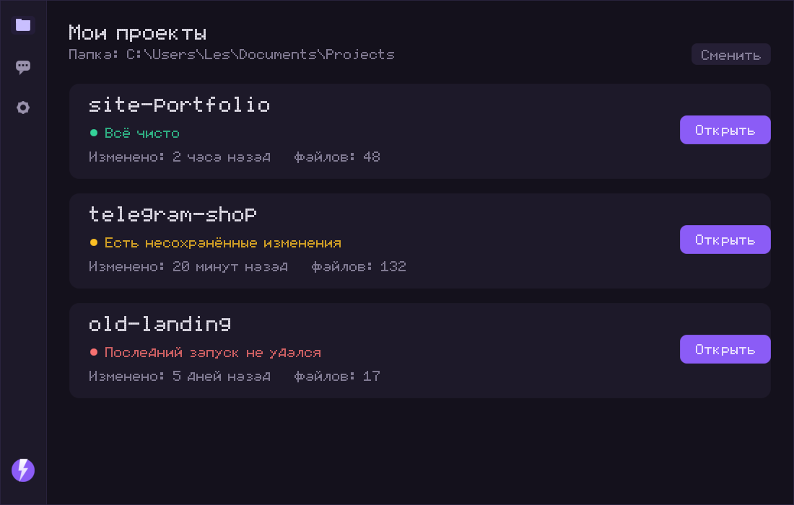

# Грок Бот

Программа-помощник для ваших проектов. Пишете простыми словами,
что хотите изменить, — она делает.



## Как начать — 5 шагов

1. **Установить.** Откройте двойным щелчком файл `GrokBot-Setup.exe`
   и нажмите «Установить», затем «Готово».
2. **Запустить.** Найдите «Грок Бот» в меню Пуск или на рабочем столе
   и откройте его.
3. **Выбрать папку.** При первом запуске программа спросит, где лежат
   ваши проекты. Нажмите «Выбрать папку» и укажите её.
4. **Открыть проект.** На экране «Мои проекты» нажмите «Открыть»
   на карточке нужного проекта.
5. **Писать.** Внизу экрана напишите, что хотите изменить — например,
   «сделай красивее» или «почини ошибку» — и нажмите «Отправить».
   Ответ и список изменённых файлов появятся на экране.
   Чтобы вернуть всё как было, нажмите «Отменить изменения».

## Если что-то не работает

- «Нет соединения» — проверьте интернет и что сервер включён.
- «Ключ не подошёл» — откройте «Настройки» и проверьте поле
  «Ключ модели».
- «Помощник долго не отвечает» — просто нажмите «Попробовать снова».

## Настройка сервера модели

Приложение ходит на сервер с моделью по адресу из поля
«Адрес сервера» (по умолчанию `http://<IP-ПК-сервера>:20128/v1`).
На ПК-сервере нужно: открыть порт **20128** в брандмауэре Windows
и закрепить за сервером **постоянный IP-адрес** в роутере.

Если сервер и приложение на одном компьютере, ничего настраивать
не нужно — адрес `http://127.0.0.1:20128/v1` уже подходит.

---

## Для разработчика

Стек: **Tauri 2 + React 18 + TypeScript + Vite**, пакетный менеджер — `pnpm`.
Интерфейс полностью на русском; все пользовательские строки живут
в `src/i18n/ru.ts` и нигде больше.

### Требования

- Node.js ≥ 20 и `pnpm`
- Rust (stable) — для `pnpm tauri build`

### Команды

```bash
pnpm install        # зависимости
pnpm tauri dev      # запуск в режиме разработки (Vite + окно Tauri)
pnpm build          # фронтенд: tsc + vite build → dist/
pnpm tauri build    # релиз → src-tauri/target/release/bundle/nsis/*-setup.exe
node tools/gen-assets.mjs   # перегенерировать app-icon.png и screenshot.png
pnpm tauri icon             # пересобрать src-tauri/icons/* из app-icon.png
```

### Конфигурация AI

Скопируйте `.env.example` → `.env` (файл в `.gitignore`, не коммитится)
и подставьте `VITE_AI_API_KEY`. Значения `VITE_AI_*` зашиваются в сборку:
во фронтенд — через `import.meta.env` (`src/config.ts`), в Rust — через
`build.rs` (`env!`). Пользователь может поменять адрес и ключ на экране
«Настройки» — они перекрывают зашитые дефолты.

Дефолты: `http://127.0.0.1:20128/v1`, модель `swe-2-max`
(OpenAI-compatible endpoint, OmniRoute).

### Структура

- `src/core/` — чистые функции без `invoke`/DOM, с инъекцией зависимостей
  (fs/git/http/clock). Вся логика приложения — здесь; покрывается
  параметризованными `node:test`.
- `src/screens/` — три экрана: «Мои проекты», «Чат», «Настройки» + онбординг.
- `src/components/` — общие компоненты (сайдбар, карточки).
- `src/services/` — тонкие адаптеры: `invoke`-обёртки и HTTP-клиент AI.
- `src/stores/`, `src/hooks/` — zustand-состояние и react-хуки.
- `src/i18n/ru.ts` — весь текст интерфейса, хелперы `t()` и `plural()`.
- `src/styles/` — глобальные стили, тёмная тема, акцент `#8b5cf6`.
- `src-tauri/` — Rust-часть: `src/commands.rs` (тонкие команды поверх
  core-контракта), `capabilities/` (разрешения), `icons/`.

Tauri-команды: `scan_projects`, `project_status`, `read_file`,
`apply_changes`, `rollback`, `git_is_repo`.

### Лицензия

MIT — см. `LICENSE-MIT`.
